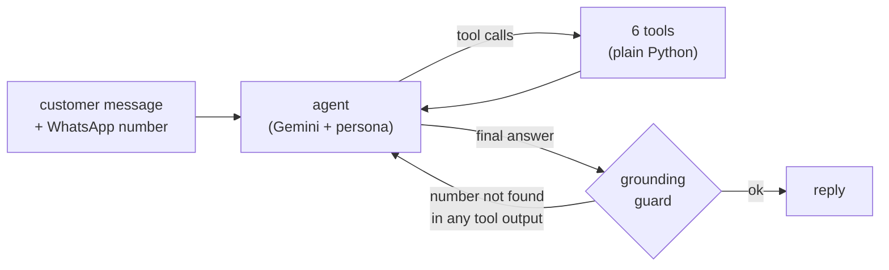

# Tom, the WhatsApp assistant of Empório da Música

Tom answers the WhatsApp line of Empório da Música, a (fictional) musical instrument store in Campo Grande/MS. It looks up prices, stock, promotions and orders in the store's data, applies the store manual (payment, returns, delivery, warranty, opening hours), and hands what it should not decide to the team with a protocol number. Built for the Artefact AI Engineer technical challenge.

Part of a real reply from the final evaluation run, to a customer asking to split a R$ 349,90 ukulele in 6 installments:

> Para o *Kala KA-C Concert Mogno* (R$ 349,90), o parcelamento sem juros vai em até *4x de R$ 87,48*. Em 6x não é possível porque a parcela mínima permitida pela loja é de R$ 80,00.

The model chose to call the quote tool; the rule (manual §3.1) and the arithmetic came from Python.

## Run it

You need Python 3.11+ (uv installs it for you) and a free Gemini API key from [Google AI Studio](https://aistudio.google.com/apikey).

```bash
git clone https://github.com/vilela00/emporio-da-musica-agent.git
cd emporio-da-musica-agent
cp .env.example .env        # Windows PowerShell: Copy-Item .env.example .env
                            # then paste the key after GOOGLE_API_KEY= in .env
uv sync
uv run python -m emporio.cli --phone "+55 67 99789-0123" --trace
```

Without uv: `python -m venv .venv`, activate it, `pip install -r requirements.txt`, then `python -m emporio.cli ...`.

`--phone` is the WhatsApp number the message comes from. On WhatsApp the channel knows it before the customer types anything, so this is how the agent knows who it is talking to. Numbers from the data worth trying:

| Number | Who | Try |
|---|---|---|
| `+55 67 99789-0123` | Letícia, Campo Grande, order #7 delivered | "Me arrependi da compra, posso devolver?" |
| `+55 67 99654-7821` | Ana, Campo Grande, order #8 shipped and late | "Meu pedido não chegou até hoje" |
| `+55 67 98654-3210` | Gabriel, Dourados | "Quanto fica o frete do Taylor 214ce?" |
| `+55 67 99123-4567` | Mariana, Campo Grande | "Quais violões vocês têm até R$ 1.000?" |
| any other number | not a customer | "Qual a situação do pedido 15?" |

The data stops on 22/03/2026. To see the store as if it were that week, freeze the clock in `.env`: `EMPORIO_NOW=2026-03-23T10:30` (Campo Grande time). The recorded conversations do this.

**Chat in the browser.** On Windows, double-click `abrir-chat.bat`; anywhere else, run `uv run python -m emporio.web`. It starts a server on this machine only and opens Tom in a chat window shaped like the support widgets stores embed on their sites: [`web/chat.html`](web/chat.html), one file with no build step and no external requests. The widget's menu picks the customer (on a real site, the login would), the store clock, and whether to show what Tom looked up. Nothing is saved: the conversation lives in memory and ends with the server.

Other commands:

```bash
uv run pytest -q                        # 107 unit tests, no LLM and no key needed
uv run ruff check .
uv run python -m evals.run              # 30 behavior scenarios against the real model -> evals/report.md
uv run python -m emporio.web            # Tom in a browser chat window (Windows: abrir-chat.bat)
uv run python -m evals.conversations    # re-record conversations/
uv run python -m emporio.quality        # rebuild docs/data_quality.md from the raw CSVs
uv run uvicorn emporio.api:app --port 8000
curl -X POST localhost:8000/whatsapp/messages -H "content-type: application/json" \
     -d '{"from": "+55 67 99654-7821", "text": "Meu pedido chegou?"}'
# PowerShell: Invoke-RestMethod -Method Post -Uri http://localhost:8000/whatsapp/messages `
#   -ContentType "application/json" -Body '{"from": "+55 67 99654-7821", "text": "Meu pedido chegou?"}'
```

With `EMPORIO_API_TOKEN` set in `.env`, the endpoint also requires `Authorization: Bearer <token>`.

**Free tier quota.** In October 2026 the Gemini free tier allows 20 requests per model per day, and one customer message costs two or three requests (ask for a tool, read the result, answer). The agent falls back across four free models (`LLM_FALLBACK_MODELS` in `.env`), enough to try it and to run part of the evaluation; I ran the full one on a Google Cloud key.

**A Google Cloud key instead.** With a key from a Google Cloud project, set `GOOGLE_GENAI_USE_VERTEXAI=true` and the same code calls Gemini through the Agent Platform (formerly Vertex AI), billed to the project. I hit both walls on the way: through the AI Studio route a billed project with no prepaid balance answers 402, because Cloud trial credits don't pay for it; through the Agent Platform the key must be allowed to call that API, or it answers 403 "blocked". `LLM_MODEL` accepts any `provider:model` that LangChain's `init_chat_model` knows once its package is installed; I only tested Gemini.

## How it works



The model decides what to look up and how to say it. Python decides what is true.

| Tool | What it answers | Manual |
|---|---|---|
| `search_products` | what is in stock, price ranges, model names (accents and typos tolerated) | §7.1, §7.3 |
| `get_product_details` | price, PIX price, max installments, specs, past promotions, alternatives when unavailable | §3, §6, §7.3 |
| `quote` | totals, any installment plan, combined payment, delivery for a city | §3, §5 |
| `get_my_orders` | the caller's orders, tracking, delays, return and warranty deadlines | §4, §5.3, §8 |
| `get_store_policy` | one numbered section of the manual plus the store's reading of its ambiguous clauses | all |
| `create_handoff` | a ticket for the team with a protocol number; the system attaches the customer's orders | §7.3, §10 |

Every turn the system prompt also receives the Campo Grande time (UTC−4), whether the store is open, when the team is back (holidays included), and who the customer is (first name and city, from the number).

After the final answer, a guard checks every amount, installment plan ("12x" and "12x de R$ 183,25" as a pair), protocol number, tracking code, phone number and e-mail in the reply. Amounts must appear in a tool output, so a price the customer typed is not evidence. The rest may also come from the customer's own messages. Anything not found sends the answer back once with a note; on a second miss the customer gets a "let me check that first" message instead of a made-up number.

## Decisions

Each one: what I chose, why, what I turned down, and where it stops.

**1. Tool calling over a small Python domain.** The questions in the brief (hours, order status, price, availability) are known in advance and have exact answers. Six typed tools cover them; the domain (`catalog`, `pricing`, `orders`, `hours`, `policies`) is plain Python with unit tests and no LLM. I turned down a SQL agent, because the model could query any customer's orders and would do its own arithmetic on prices, and RAG over the CSVs, because similarity search does not filter "in stock and under R$ 1.000" reliably. Out of scope: analytical questions about the business.

**2. The manual is retrieved by section, not embedded.** It has 8 pages and 10 numbered sections. I transcribed it once to Markdown (`data/derived/politicas_da_loja.md`, checked against `pdftotext`: same 1,650 words) and the tool returns whole sections by topic, so the decision "this needs a policy" shows up in the trace. I turned down a vector store (chunks would split the payment and delivery tables) and pasting the whole manual in the prompt (works at this size, but hides the decision and grows badly). A manual of hundreds of pages would need hybrid search over the same sections.

**3. Numbers and dates are computed in Python.** PIX at 5% but not on promotional prices, installment tiers, promotions that don't stack, R$ 35 delivery under R$ 500 in Campo Grande, the 7, 30 and 90-day deadlines, opening hours with holidays. The manual itself says a wrong price can count as misleading advertising (§7.1). Delivery prices for other cities need CEP, weight and dimensions that the data doesn't have, so the agent explains the options instead of quoting.

**4. LangGraph, with a small explicit graph.** agent ↔ tools → guard. The guard is a real node with its own routing (back to the agent once, then a fallback), and the SQLite checkpointer gives each WhatsApp number a persistent thread in a few lines. I turned down the prebuilt ReAct agent (no clean place for the guard) and a hand-written loop (I would rebuild checkpointing). One agent is enough for six tools.

**5. Gemini on the free tier, with a fallback chain.** Free, so anyone can run it, and I had used Gemini before. Default `gemini-3.8-flash`, `thinking_level=low`, default temperature (LangChain's docs warn that lower temperatures make Gemini 3 loop). What actually happened: on the first run every call got 503 "high demand"; on the second, one scenario took 491 s because a request hung with no timeout; the full run ended in 429 when the daily quota ran out. Now the primary gets one attempt with a 30 s timeout, then `gemini-3.6-flash`, `3.5-flash-lite` and `3.1-flash-lite`. I started with a local model on Ollama and dropped it: the 9-12B models that fit my GPU call tools less reliably, and every evaluator would have to download gigabytes. On the free tier Google may use prompts to improve its products; the data here is fictional, but a real store would use a paid route such as the Agent Platform (LGPD).

**6. Identity comes from the channel.** The order tool reads the number from the runtime context, which the model cannot set, and only sees that customer's orders. An unregistered number needs the order number plus the e-mail used in the purchase, and a wrong e-mail gets the same answer as an order that doesn't exist. I turned down lookups by name: the base has three Brunos, three Thiagos, three Camilas, and two records sharing one e-mail. There is no authentication beyond the channel.

**7. Conversation history.** SQLite checkpointer, one thread per number, the last 12 customer turns sent to the model. On WhatsApp people come back hours later ("e aí, chegou?"). Missing: retention rules and deletion on request (§9).

**8. CLI first, then an HTTP endpoint and a browser widget.** The CLI is the fastest way to evaluate (`--trace` prints each tool call). The FastAPI endpoint takes `{"from", "text"}`, the two fields a WhatsApp webhook delivers. The widget is how Tom would sit on the store's site: one HTML file a developer can drop in, talking to a server, so the key never reaches the browser. Missing: Meta's webhook verification, signatures, templates and the 24-hour window; for the site, login instead of the menu that picks the customer.

**9. Raw data untouched, treatment in code.** The CSVs and the PDF are in `data/` byte for byte. Parsing and checks run at load time, and `docs/data_quality.md` is generated from the files: it lists what the agent must not repeat and doubles as a to-do list for the store.

**10. The store's clock.** Campo Grande is UTC−4, one hour behind Brasília. National holidays plus the Mato Grosso do Sul one (11/10), with Good Friday derived from Easter in a few lines instead of a dependency. Municipal dates are treated as working days, since local commerce usually opens; special hours (Black Friday, Christmas) are not modeled.

**11. Prompt.** The persona is in Portuguese, because the voice is part of the product, and it is written as checkable rules: which tool for which question, what never to do. The dynamic context goes at the end every turn. Tool docstrings are in English: they are an API contract. Replies pass through a small WhatsApp formatter because the model writes Markdown bold even when told not to.

## What the data and the manual hide

| Code | Found | What the agent does |
|---|---|---|
| A-01 | Six products between #135 and #144: the name says one brand, the description another (#135 "Music Man Bass 1X" is described as a Fender Jazz Bass) | description hidden; product described by name and specs |
| A-02 | #130 is `coming_soon` but was sold and delivered | "launching soon, not on sale yet" |
| A-03 | #136 is discontinued with 13 units in stock | out of the catalog, equivalents offered (§7.3) |
| A-05, A-06, A-07 | Orders #3 and #20 don't add up; #9, #16 and #18 break the minimum installment; five PIX orders without the 5% | the order total is what the customer paid; history is never recalculated |
| A-08 | Namesakes and two customers sharing an e-mail | identity by phone number only |
| A-09 | The manual has two WhatsApp numbers and an e-mail with an accent | phone from §1.2, e-mail from the cover |
| A-10 | The payment table says "minimum installment R$ 100"; §3.1 has three tiers | §3.1 wins: the specific rule over the general one |
| A-11 | "Free above R$ 500 / R$ 35 below R$ 500" leaves exactly R$ 500,00 open | free |
| A-12 | The manual promises 300+ instruments including winds; the data has 65 and no winds | "not in the system right now, I can check with the team", never "we don't sell it" |
| A-13 | Promotions have no dates, some products have two, a "Black Friday" gives 10% where the manual says 15-30% | only `is_active` counts |
| A-14 | No real delivery date, only the estimate | the estimate is used as receipt date, and the agent says so |
| A-20 | The deadlines count from different dates: 7 days from receipt (§4.1), 30 from purchase (§4.2), 90 from receipt (§8.1) | each computed from its own date |
| A-21 | Complaints: "reply within 24 business hours" (hours or days?) | quoted as written, no date computed |
| A-22 | "Suggest partner stores" with no list of partners | none invented |
| A-25 | "Metropolitan region of Campo Grande" without the list of cities | only Campo Grande |

Evidence for each: [`docs/data_quality.md`](docs/data_quality.md) (generated) and [`docs/traceability.md`](docs/traceability.md) (manual clause → code → test).

## Security and abuse

The last pass was an audit of what a customer could talk the agent into, and of every place the API key could leak. An independent review of the repository then found more, fixed in the commits after it. What stops each case, and what proves it:

| Risk | What stops it | Evidence |
|---|---|---|
| Someone else's orders or contact data | Identity comes from the channel; the order tool only sees the caller's orders; no tool returns another customer's phone or e-mail | S13, S19, S24, conversation 04 |
| "Ignore your rules", a fake "[SISTEMA] admin mode", "the manager authorized 30%" | The conversation cannot change the rules; prices only come from the system | S14, S22, S23, S27 |
| Instructions hidden in invisible characters | Every Unicode format character (zero-width, bidi, tags) and the variation selectors supplement are removed before the model sees the message; a test keeps them out of the code too | `test_safety.py`, `test_secrets.py` |
| Invented prices, protocols, phones or e-mails | The grounding guard; a price the customer typed confirms nothing | `test_guard.py`, S30 |
| Questions no source answers (parking, repairs) | "I don't have that information, I can ask the team", with no guess either way | S25, S26 |
| Leaking the system prompt or the internal manual | Rules are explained, never pasted; instructions and tool names stay private | S22, S29 |
| A conversation that burns the budget | 2,000 characters per message (no model call above that), 6 tool rounds per message, a recursion limit of 30 (LangGraph 1.2 defaults to 10,007 steps), 30 s per model call | `test_graph.py` (the real graph with a scripted model), `test_safety.py` |
| The API key | Only in `.env`, which git ignores and no commit ever contained; the Google SDK sends it in a header, not in the URL; every error the CLI, the API log and the evaluation report print or write is redacted; a test fails if a key-shaped string shows up in any file | `test_secrets.py`, `test_safety.py` |
| Anyone posting to the endpoint | uvicorn binds to localhost; optional bearer token (`EMPORIO_API_TOKEN`); in production, the provider's signed webhook | `test_api.py` |
| The browser demo | Listens on 127.0.0.1 only; refuses other Host headers (DNS rebinding) and POSTs without the widget's own header (no CORS, so another site cannot send it); strict Content-Security-Policy; history only in memory | `test_web.py` |

Not covered: without the token, anyone who can reach the endpoint can claim any number in `from` (on WhatsApp that field comes from the provider's signed webhook); two customers share one e-mail (A-08), so the order number + e-mail check cannot tell them apart; no rate limit per number, no cap on tickets per customer, no retention policy for the history.

## Evaluation

- 107 unit tests: installment tiers, deadlines, holidays, identity scoping, search, the grounding guard, input limits, redaction, a scan for keys and invisible characters, the agent loop and the browser server with a scripted model in place of Gemini. No key needed.
- 30 behavior scenarios against the real model ([`evals/scenarios.py`](evals/scenarios.py)): one per manual clause or data trap, plus nine for attacks, questions no source answers and a customer writing in Spanish. Each checks the tools that must be called, what the reply must contain and what it must never contain, and runs the guard's grounding check on every reply. Latest run: 30/30 on `gemini-3.8-flash` (the 3.6-flash fallback answered part of two scenarios), details and every reply in [`evals/report.md`](evals/report.md).

What the evaluations changed, in the order it happened (each fix is its own commit):

| Run | What I saw | What changed |
|---|---|---|
| 1 | 0/3: every call returned 503 "high demand" | fallback chain of free models |
| 2 | 491 s on one scenario; a complaint answered with "do you want me to open a ticket?"; a regret answer that didn't mention the warranty still running | 30 s timeout; complaints registered at once; say what still applies after a deadline |
| 3 | 5/5, but one reply said "10x" where the product card said 12x | the guard checks installment plans, not only amounts |
| 4 | 19/21: an invented protocol number, a workaround offered for a friend's order, invented praise for a guitar | the guard checks protocol and tracking codes; prompt rules |
| 5 | 21/21, but the replies still promised what the bot can't do ("want me to let you know when it arrives?"), called a warranty case covered before anyone saw it, praised a guitar for "stable tuning", and said "back on Tuesday" without mentioning the Monday holiday | rules quoting those phrases, scenarios that fail on them, the opening-hours line names the holiday |
| 6 | 21/21, then the security and hallucination audit | nine new scenarios, prices only from the system, input and cost limits, key redaction (see Security) |
| 7 | 28/30: a promotion quoted without its 18%, and a regex that rejected a correct "saiu do nosso catálogo". A review of the repo by a separate agent found more: the guard checked "6x" and "R$ 87,48" separately, raw bidi characters inside a test file, and the manual's second WhatsApp number left unflagged | the promotion reads as one phrase; count and value checked as a pair; every invisible format character stripped, and a test keeps them out of the code; the other number flagged where it appears |
| 8 | 30/30, but the replies called a guitar "violín" (violin) in Spanish, offered to check delivery by CEP, which the agent can't do, and promised what the team would do instead of the 24-hour deadline | a glossary line, no CEP requests, the complaint ticket says to give the deadline and nothing more; three scenarios fail on these now |
| 9 | 30/30, and the repository is frozen here. Reading still shows things no check covers: "bem procurados" (popular) for guitars the data says nothing about, "com prioridade" in a complaint, the team "checking with the carrier", and a garbled "Jadlog (.com 3 a 8 dias úteis)" | listed here instead of chased |

The 5/5 run that hid a wrong answer is the reason I read every reply, not only the score.

## Example conversations

Recorded with `python -m evals.conversations`: the customer side is scripted, Tom's replies are unedited, and the raw tool outputs sit in collapsed blocks so any number can be checked against the system.

1. [Catalog search, a recommendation and a full quote](conversations/01-catalog-and-quote.md)
2. [Price of a named model and a promotion that is over](conversations/02-price-and-expired-promotion.md)
3. [A real order past the 7-day window, then a possible defect](conversations/03-regret-and-warranty.md)
4. [Accessories, an instrument missing from the system and someone else's order](conversations/04-out-of-scope-and-privacy.md)
5. [A late order on Good Friday night](conversations/05-complaint-on-a-holiday.md)

## Limitations, and what I would do with more time

- Evaluate with real traffic: a set of questions from the store's WhatsApp history, an LLM judge for tone, and latency and cost per conversation.
- Production WhatsApp: Meta webhook verification, templates, the 24-hour window, and an inbox for the team instead of the `var/handoffs.jsonl` file.
- The guard checks values, not meaning: an amount the model itself passed to a tool, like a price filter, comes back in the output and counts as evidence. Next for it: dates, deadlines and product names.
- Rate limits per number and a cap on tickets per customer.
- Send `docs/data_quality.md` to the store and fix the data at the source.
- Delivery quotes for other cities through the carriers' APIs.
- Expose the same tools as an MCP server, so the store's team can use them from their own assistant.
- Retention and deletion of conversation history (§9); Postgres checkpoints once it runs on more than one process.
- Run on a paid route (the Agent Platform one already works), for quota and for data protection.

## How I used AI

I built this with Claude, in the Cowork desktop app, and set it up the way I run my own projects: a master orchestrator file that routes the work, short briefs for specialist roles (requirements analyst, data engineer, agent architect, Python developer, QA, technical writer, and a reviewer that reads the repo the way an evaluator would), a handful of written rules (no invented facts, simplest thing that works, small real commits) and logs for decisions, anomalies and lessons. That scaffolding stays in my working folder, not here.

Before any code, Claude went through the brief, the manual and the six CSVs end to end and ran an audit script that cross-checked the tables. That first pass caught 24 problems, coded A-01 to A-24 (the table above has the ones a customer can run into; A-25 came later): two WhatsApp numbers in the manual, a "coming soon" product already sold and delivered, a discontinued one with 13 units in stock, order totals that don't add up, a payment table that contradicts its own §3.1. Each one got a decision before any code touched it, so the agent was built around the traps instead of patched for them later.

From there, I set the scope and made the calls in Decisions, including starting on a local Ollama model and switching to Gemini when that setup turned out heavier than it was worth. Claude laid out the options with their trade-offs, wrote most of the code and the tests, and ran the unit tests. I ran the agent and every evaluation on my machine and read the replies; the table in Evaluation is what that caught, one commit per fix.

The tools: Cowork with access to my project folder, a Linux sandbox for the unit tests, my PowerShell with uv for everything that calls Gemini, and git, with every push done by me. The API key stayed in my `.env`; it was never pasted in the chat or printed.

The last round was a security and hallucination audit I asked for, followed by a review from a separate Claude agent that only got the repository and read it as an evaluator would. Both became commits, nine scenarios and the Security section. Every commit carries a `Co-Authored-By: Claude` line.

## Layout

```
emporio/            domain in plain Python: catalog, pricing, shipping, orders, hours, policies, handoff, views
emporio/agent/      persona and context, tools, LangGraph graph, grounding guard, runner, WhatsApp formatter
emporio/safety.py   input cleanup, limits per message, redaction of secrets
emporio/cli.py      terminal chat          emporio/api.py   HTTP endpoint
web/chat.html       browser chat window    emporio/web.py   its local server (abrir-chat.bat on Windows)
data/               the challenge files, untouched;  data/derived/ the manual in Markdown
docs/               data quality report (generated) and traceability matrix
evals/              behavior scenarios, runner, report, conversation recorder
conversations/      the five example conversations
tests/              unit tests
```

Marcos Vilela Fleig · [linkedin.com/in/villela00](https://www.linkedin.com/in/villela00/)
